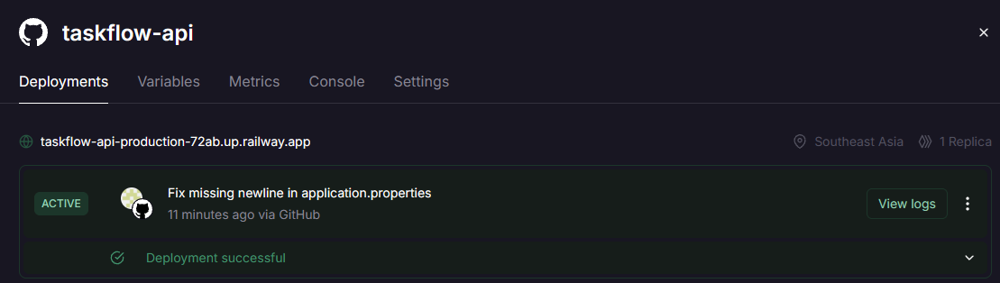
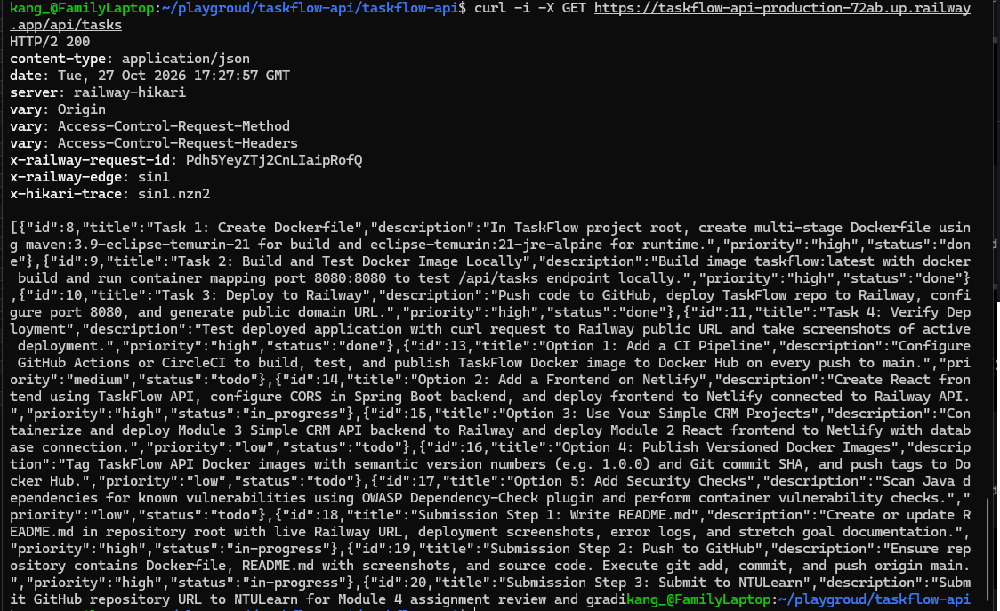
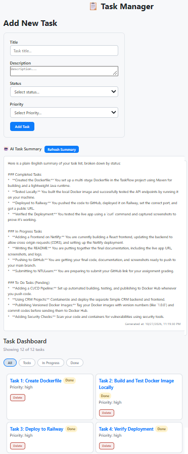
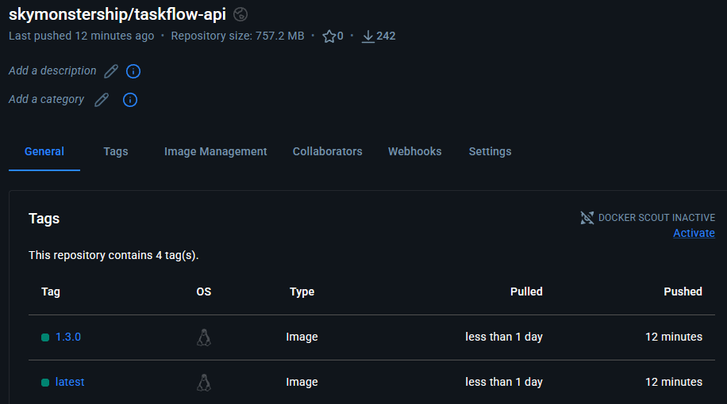

# TaskFlow API - Dockerize & Deploy

## Live Application & Pipeline URLs
* **Backend GitHub Repository**: [https://github.com/skymonstership/module4-taskflow-api](https://github.com/skymonstership/module4-taskflow-api)
* **Frontend GitHub Repository**: [https://github.com/skymonstership/task-manager](https://github.com/skymonstership/task-manager)
* **Railway Backend API Endpoint**: [https://taskflow-api-production-72ab.up.railway.app/api/tasks](https://taskflow-api-production-72ab.up.railway.app/api/tasks)
* **Netlify Frontend Application**: [https://skymonstership-taskflow-app.netlify.app](https://skymonstership-taskflow-app.netlify.app)
* **GitHub Actions Pipeline Run (Passed ✅)**: [https://github.com/skymonstership/module4-taskflow-api/actions/runs/40541633487](https://github.com/skymonstership/module4-taskflow-api/actions/runs/40541633487)
* **Docker Hub Repository**: [https://hub.docker.com/r/skymonstership/taskflow-api](https://hub.docker.com/r/skymonstership/taskflow-api)

---

## Deployment Screenshots

### 1. Railway Dashboard (Active Deployment)


### 2. Live API Endpoint Working


### 3. Netlify Frontend Connected to Railway API & AI Summary


### 4. Docker Hub Repository & Versioned Tags


---

## Completed Assignment Tasks & Features

- [x] **Task 1: Create Dockerfile**
  - Created a multi-stage Dockerfile in the project root.
  - Stage 1 uses `maven:3.9-eclipse-temurin-21` to compile the Java JAR without requiring a local Maven installation.
  - Stage 2 copies the compiled JAR into a lightweight `eclipse-temurin:21-jre-alpine` runtime image exposing port `8080`.

- [x] **Task 2: Build and Test Docker Image Locally**
  - Built local image using `docker build -t taskflow:latest .`.
  - Ran container using `docker run -p 8080:8080 taskflow:latest`.
  - Verified local API responses via `curl http://localhost:8080/api/tasks`.

- [x] **Task 3: Deploy to Railway**
  - Pushed Dockerfile and application source code to the GitHub repository.
  - Connected repository to Railway, which automatically detected the multi-stage `Dockerfile`.
  - Configured networking and generated a public domain URL.

- [x] **Task 4: Verify Deployment**
  - Tested live Railway endpoints using `curl` and confirmed active HTTP 200 responses.

- [x] **Add Database (Supabase PostgreSQL Setup)**
  - Configured a cloud-hosted Supabase PostgreSQL database for persistent storage.
  - Implemented Spring Data JPA entities (`Summary`) and JPA Repositories (`SummaryRepository`) to manage persistent AI summary state.
  - Routed Railway backend traffic through Supabase's **IPv4 Session Pooler** (`*.pooler.supabase.com:5432`) to establish high-availability database connections.

- [x] **AI Summary Component**
  - Integrated Spring AI with Gemini API to provide intelligent, natural-language summaries of the task board.
  - Returns a JSON response structure (`id`, `summaryText`, `generatedAt`) and formats timestamps dynamically in the frontend UI.

---

## Errors, Failures & Technical Challenges

In accordance with course guidelines on experimenting and troubleshooting, the following real-world issues were encountered and resolved during implementation:

### 1. Technical Challenge: Reducing Gemini API Calls (Persistent Database Caching)
* **Problem**: Executing live Gemini AI API requests on every page refresh or task list read caused unnecessary token consumption, higher latency, and risk of rate limit errors.
* **Cause**: The original design dynamically generated summaries whenever the frontend requested the `/api/tasks/summary` endpoint.
* **Resolution**: Re-architected the system to strictly separate Read and Write operations:
  - **Read Operations (`GET /api/tasks/summary/cached`)**: Page loads and C/U/D actions fetch pre-computed summary records directly from the Supabase database with **0 Gemini API token consumption** and ~50ms response times.
  - **Write Operations (`GET /api/tasks/summary`)**: Triggered exclusively when the user manually clicks the **"Refresh Summary"** button or updates tasks, calling Spring AI to recalculate the summary and persist it to Supabase for future cached reads.

### 2. Railway to Supabase Database Connection (`Network unreachable`)
* **Error**: `java.net.SocketException: Network unreachable` during startup on Railway.
* **Cause**: Railway container instances run on IPv4 networks by default, whereas Supabase direct connection endpoints use IPv6 addresses.
* **Resolution**: Switched the `DB_URL` environment variable on Railway to use Supabase's **IPv4 Session Pooler** endpoint (`*.pooler.supabase.com:5432`) and updated `DB_USERNAME` to include the project reference suffix.

### 3. Cross-Origin Resource Sharing (CORS) Blocking Netlify Frontend
* **Error**: `Access to fetch at ... from origin 'https://skymonstership-taskflow-app.netlify.app' has been blocked by CORS policy`.
* **Cause**: Backend API lacked cross-origin header permissions for the external Netlify domain.
* **Resolution**: Replaced hardcoded origins with dynamic environment variable support in Spring Boot:
  ```java
  @CrossOrigin(origins = "${FRONTEND_URL:http://localhost:5173}")

### 4. Minified React Error #31 & UTC Timestamp Parsing
* **Problem**: Object serialization crashes in React and an 8-hour timestamp shift on local client displays.
* **Solution**: Updated `AISummary.jsx` to safely extract JSON object properties and normalized ISO strings with explicit `Z` UTC indicators before local time conversion.

---

## Stretch Goals Implemented (Options 1 – 5)

* **OPTION 1: ADD A CI PIPELINE** — **Completed**
  - Configured automated `.github/workflows/ci.yml` pipeline executing build, test, and container publish jobs on pushes to `main`.
  - Credentials stored securely via GitHub Secrets (`DOCKER_USERNAME`, `DOCKER_TOKEN`).
  - [View Successful Pipeline Run](https://github.com/skymonstership/module4-taskflow-api/actions/runs/40541633487)

* **OPTION 2: ADD A FRONTEND ON NETLIFY** — **Completed**
  - Single-page application providing full task management, status filtering, and dynamic AI summary rendering connected to the Railway API.
  - [Frontend GitHub Repository](https://github.com/skymonstership/task-manager)
  - [Live Frontend Web App](https://skymonstership-taskflow-app.netlify.app)

* **OPTION 3: USE YOUR SIMPLE CRM PROJECTS** — **Pending**

* **OPTION 4: PUBLISH VERSIONED DOCKER IMAGES** — **Completed**
  - Published tagged container images (`latest`, `1.3.0`) to Docker Hub.
  - [Docker Hub Repository](https://hub.docker.com/r/skymonstership/taskflow-api)

* **OPTION 5: ADD SECURITY CHECKS** — **Pending**  